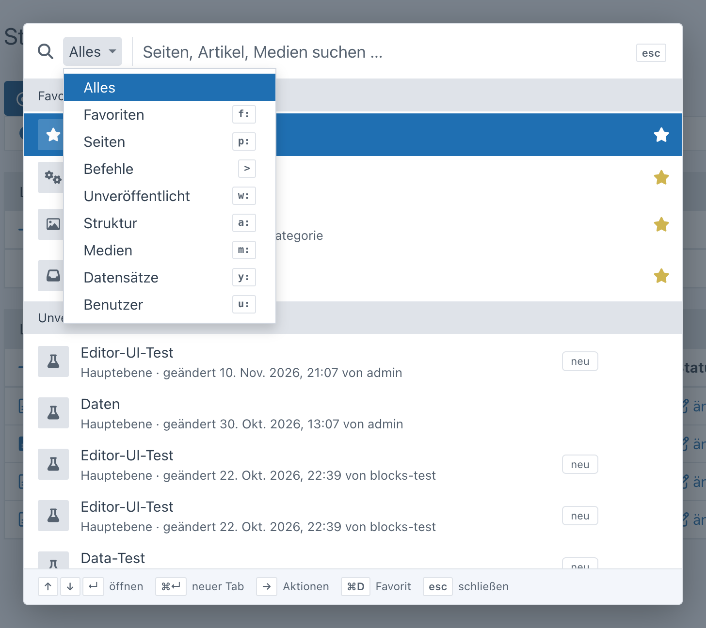
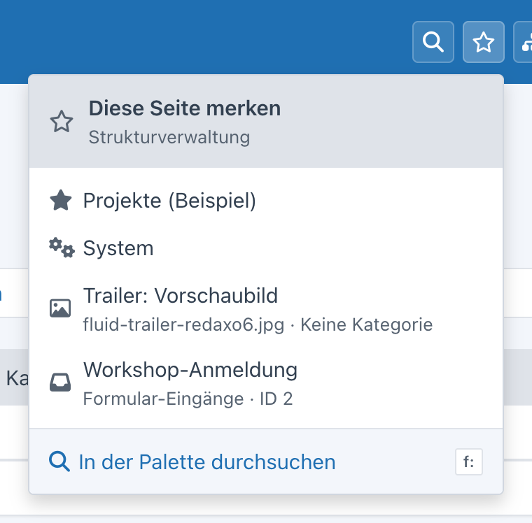

<p align="right">🌎 <a href="https://github.com/FriendsOfREDAXO/quick_navigation/blob/main/README.de.md">Deutsch</a></p>

# Quick Navigation for REDAXO 6

Get anywhere in the backend fast: a **command palette** with live search across pages, structure, media, YForm records
and users, with **commands** (`>`) and per-user **favorites**, a **structure tree** with search, **YForm tables** with
“+” for new records and a **live search in the media pool** – always limited to what the signed-in user is allowed to
open. Other addons add their own search sources and register their domains.


> Version 10 (branch `main`) is a rewrite for REDAXO 6 and not compatible with Quick Navigation 9.x for
> REDAXO 5 – that one lives in the branch [`redaxo-5.x`](https://github.com/FriendsOfREDAXO/quick_navigation/tree/redaxo-5.x). The screenshots show the German backend.

## Installation

```bash
composer require friendsofredaxo/quick_navigation:10.x-dev
php bin/console migrate
```

## Command palette

**⌘K** (Mac) or **Ctrl+K** – or the magnifier in the top bar – opens the palette. Without input it shows your favorites,
the **recently opened** results (stored in the browser) and the **recently edited** articles; while typing it searches
live, grouped by source, with the matches highlighted.

<p>
  
  
</p>

| Key | Action |
| --- | --- |
| ⌘K / Ctrl+K | open or close the palette |
| ↑ ↓ | select a result |
| Page ↑ / Page ↓ | previous / next group |
| ↵ | open |
| ⌘↵ / Ctrl+↵ / ⇧↵ | open in a new tab |
| → / ← | extra actions of the result (e.g. “show in structure”, “view”) |
| ⌘D / Ctrl+D | add to / remove from favorites |
| esc | clear the input, then close |

To search a single source, use the selector left of the search field (“Everything”, “Pages”, “Media” …, with the prefix
shown next to each) or type the prefix directly. The selector puts the prefix into the field and keeps the search term;
typing a prefix updates the selector. A number finds the article with that ID.



| Prefix | Source |
| --- | --- |
| `f:` | favorites |
| `>` | commands – see below |
| `w:` | unpublished – pages whose working version differs from the live version (only with the working version enabled) |
| `p:` | backend pages (including subpages of addons) |
| `a:` | articles and categories – by name or ID |
| `m:` | media pool – media by title and file name (with thumbnail) and media categories |
| `y:` | YForm records – text fields of all tables you may view, or the ID (only with YForm) |
| `u:` | users (only with permission for user management) |

<p>
  
  
</p>

### Favorites

Every user has their own favorites – stored on the server, so they are the same in every browser.

The **star in the top bar** is filled when the current page is a favorite. Clicking it opens the favorites: at the top
“remember this page” or “remembered – remove”, below the favorites to jump to (× removes, a filter appears from eight
entries), at the bottom “search in the palette”.

<p>
  
</p>

In the palette, the star on a result or **⌘D / Ctrl+D** adds it: pages, articles, categories, media, media categories,
YForm records and commands such as “New record: Projects”. The command **“Remember this page”** (`>`) adds the page
you are on – including a filtered YForm list or an addon page. Without input the favorites are listed first, `f:`
shows only them; the same star removes them again.

The address is stored without security token. Pages for viewing, editing and adding don’t need one (YForm checks the
token only when saving and deleting via POST); commands with a token such as “clear cache” can’t be added.

### Unpublished

With the working version enabled (System → Settings), the palette lists pages whose working version differs from the
live version – blocks, order, content or status, “new” for pages without a live version. Without input the latest ones
appear right away, `w:` lists all; path, time and the last editor are shown in the second line. This covers the core’s
working version and therefore fluid as well.


### Commands

With `>` the palette shows commands; matching ones also appear in the normal search – each only if the user may run it:

- new article / new category – in the category you are in (otherwise the root level)
- upload medium
- new record for every YForm table you may edit
- admins only: edit table structure (YForm designer), new user, clear cache

Commands are not added to “recently opened”.


An addon adds further commands via the extension point `QuickNavigationCommands` (a list of `Item`, permissions via
`$ep->query->user`):

```php
Extension::register(QuickNavigationCommands::class, static function (QuickNavigationCommands $ep): array {
    $commands = $ep->subject;
    if ($ep->query->user->admin) {
        $commands[] = new Item('Regenerate sitemap', Url::backendPage('seo/sitemap', ['func' => 'generate']), icon: 'rex-icon fa-sitemap');
    }

    return $commands;
});
```

## Structure tree

The button next to the star opens the structure as a tree – expanded down to the article or category you are on.
Sublevels load when expanded. Clicking a category opens it in the structure, clicking an article opens its content;
“edit content” and “view” appear on hover. With several languages you switch at the top. Users with access to parts of
the structure only see their mount points.

The search field at the top of the tree searches the whole structure (name or ID) and shows only the matches with their
categories, expanded.

<p>
  
  
</p>

Keyboard: the search field has the focus when opening, ↓ moves into the tree, ↵ opens the first match. In the tree:
↑ ↓, → expand or go in, ← collapse or go up, Home/End, ↵ open (⌘↵ new tab), a letter jumps to the next entry starting
with it, esc closes.

## YForm

With YForm, another button appears in the top bar: it lists the tables the user may view (with a filter from seven
tables), “+” adds a new record right away (only with edit permission), and “search records” opens the palette with `y:`.
The search covers all text fields of the permitted tables; without a search term `y:` shows the newest records per table.

<p>
  
  
</p>

## Media pool

In REDAXO 6 the media pool runs as a window of its own or as an overlay when choosing a medium. There, Quick Navigation
extends the existing search field:

- **Live search:** results appear below the field while typing (thumbnail, file name, category, size), ↑ ↓ select,
  ↵ opens the medium.
- **Recently edited:** clicking into the empty search field shows the most recently changed media.
- **Choosing:** in the picker mode of a media field every result has “select”, ↵ selects right away; the file types
  allowed by the field apply here as well.
- **Sorting:** the button next to the search switches the list between “newest first”, file name and title (remembered).
- **Browsing:** in the detail view of a medium ‹ › (or the arrow keys ← →) go to the previous or next medium – in the
  same order as the list (category, file types, sorting); a preview on hover shows where it goes. Also in picker mode,
  “select” stays.


## Permissions

The search runs through API functions (read-only, with CSRF token). Every source checks on its own:

- **Pages:** `Page::checkPermission()` – like the navigation; hidden pages and popups are left out
- **Structure and tree:** category permissions (`StructurePermission`, mount points) and language permissions
- **Media:** media pool permissions per category (`MediaPoolPermission`)
- **YForm:** view or edit permission per table (`Access::canView()`/`canEdit()`); “+” only with edit permission
- **Users:** permission `users[]`; only admins see admins
- **Unpublished:** category and language permissions as in the structure
- **Commands:** the matching permission per command (adding in the category, media pool, YForm editing); designer,
  new user and clear cache for admins only

## Custom sources

An addon provides results with a class that implements `Provider` and carries the attribute `AsProvider` – that’s all,
the class is discovered automatically:

```php
use FriendsOfRedaxo\QuickNavigation\Action;
use FriendsOfRedaxo\QuickNavigation\AsProvider;
use FriendsOfRedaxo\QuickNavigation\Item;
use FriendsOfRedaxo\QuickNavigation\Provider;
use FriendsOfRedaxo\QuickNavigation\Query;
use Redaxo\Core\Filesystem\Url;

#[AsProvider('news', priority: 40, prefix: 'n')]
final class NewsProvider implements Provider
{
    public function label(?Query $query = null): string
    {
        return 'News';
    }

    public function search(Query $query): iterable
    {
        // check permissions – only return what the user may open
        if ($query->isEmpty() || !$query->user->hasPerm('news[]')) {
            return;
        }

        foreach (News::query()->where('title', $query->like(), 'LIKE')->find() as $news) {
            $score = $query->score($news->title, $news->teaser);
            if (0 === $score) {
                continue;
            }

            yield new Item(
                title: $news->title,
                url: Url::backendPage('news', ['func' => 'edit', 'id' => $news->id]),
                meta: $news->date->format('Y-m-d'),
                icon: 'rex-icon fa-newspaper',
                badge: $news->online ? null : 'offline',
                actions: [new Action('View', $news->getUrl(), 'rex-icon rex-icon-external-link', external: true)],
                score: $score,
            );
        }
    }
}
```

- `AsProvider(key, priority, prefix, limit)` – `priority` orders the groups (favorites 110, pages 100, commands 95,
  unpublished 92, structure 90, media 80, YForm 60, users 50), the same `key` with a higher priority replaces an existing
  source, `prefix` is the prefix for `x:`, `limit` the number of results without prefix (default 6).
- `Query` – `term`, `words`, `user`, `limit`, `scoped` (chosen by prefix), `isEmpty()`, `isId()`, `like()` (ready-made
  pattern for SQL `LIKE`) and `score()` for the order (equal > starts with > word start > contains, 0 = no match).
- `Item` – title, address, second line, icon or thumbnail, badge, extra actions; `score` sorts within the group.
- With empty input a source may return suggestions (e.g. “recently edited”) or nothing.

Without the attribute, e.g. depending on configuration, in the `boot()` of your addon:

```php
QuickNavigation::register('news', new NewsProvider(), priority: 40, prefix: 'n');
QuickNavigation::unregister('users'); // switch off a built-in source
```

If a source throws an exception, only its group is missing (in dev mode the error is shown).

## Domains

Quick Navigation doesn’t know about domains itself – addons that manage them (fluid, yrewrite …) register them via the
extension point `QuickNavigationDomains`. From two domains on, the structure tree shows a selector at the top
(preselected is the domain of the current page, plus “all domains”): the tree then starts in the domain’s mount
category, the mount categories of the other domains are hidden, and the tree search stays within the domain. In the
palette, articles and categories carry the domain as a badge.

<p>
  
  
</p>

A domain has a key, a name, its mount category (`0` = whole structure) and its address. Registering does no harm when
Quick Navigation is missing – `::class` doesn’t load a class, the closure only runs when the extension point is
dispatched. For yrewrite, for example:

```php
use FriendsOfRedaxo\QuickNavigation\Domain\Domain;
use FriendsOfRedaxo\QuickNavigation\ExtensionPoint\QuickNavigationDomains;
use Redaxo\Core\ExtensionPoint\Extension;
use Yakamara\YRewrite\YRewrite;

Extension::register(QuickNavigationDomains::class, static function (QuickNavigationDomains $ep): array {
    $domains = $ep->subject;
    foreach (YRewrite::getDomains() as $name => $domain) {
        if ('default' !== $name) {
            $domains[] = new Domain($name, $domain->getHost(), $domain->getMountId(), $domain->getUrl());
        }
    }

    return $domains;
});
```

For fluid accordingly: the primary domain with `0`, landing domains with subpages with their category.

## Technology

- search, favorites, structure tree and YForm tables as buttons in the backend top bar – without touching the core
- `<dialog>` with ARIA combobox and listbox, the tree as ARIA tree, screen reader announcements, `prefers-reduced-motion`
- colors and components of the core (tokens, select, dropdown) – light and dark without own rules
- no inline styles or handlers (content security policy of the backend)

## License

MIT, see [LICENSE](LICENSE).
