# Quick Navigation für REDAXO 6

Schnell überall hin im Backend: eine **Befehlspalette** mit Live-Suche über Seiten, Struktur, Medien, YForm-Datensätze
und Benutzer und mit **Befehlen** (`>`), ein **Strukturbaum** mit Suche, **YForm-Tabellen** mit „+“ für neue Datensätze und eine **Live-Suche im
Medienpool** – immer nur über das, was der angemeldete Benutzer auch öffnen darf. Andere AddOns erweitern die Suche um eigene Quellen und tragen ihre Domains ein.


> Version 10 (Branch `redaxo-6.x`) ist eine Neuentwicklung für REDAXO 6 und nicht kompatibel zu Quick Navigation 9.x
> für REDAXO 5.

## Installation

```bash
composer require friendsofredaxo/quick_navigation:10.x-dev
php bin/console migrate
```

## Befehlspalette

**⌘K** (Mac) bzw. **Strg+K** – oder die Lupe in der Kopfleiste – öffnet die Palette. Ohne Eingabe zeigt sie die
**zuletzt geöffneten** Treffer (im Browser gespeichert) und die **zuletzt bearbeiteten** Artikel; beim Tippen sucht sie
live, gruppiert nach Quelle, die Fundstellen hervorgehoben.

<p>
  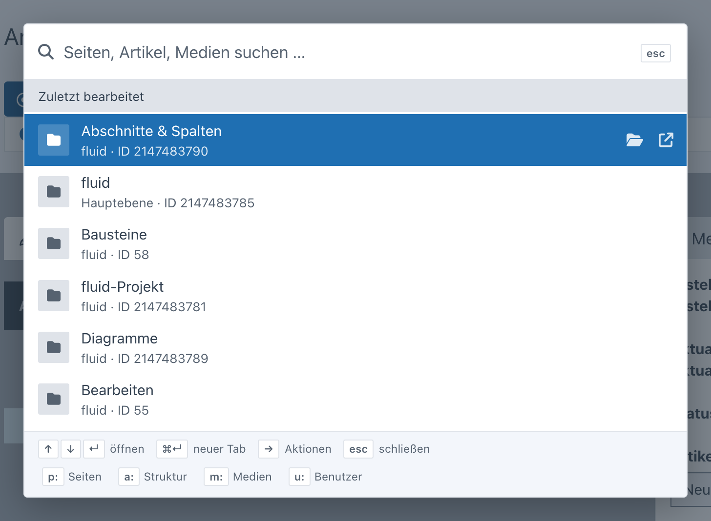
  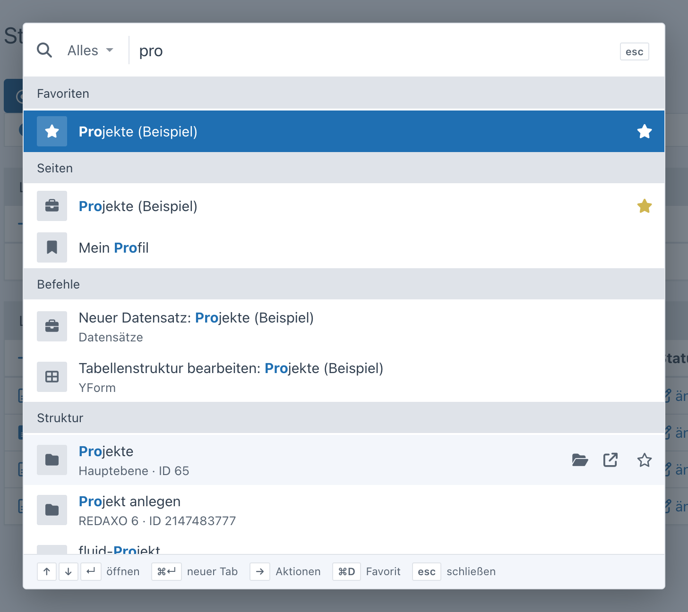
</p>

| Taste | Wirkung |
| --- | --- |
| ⌘K / Strg+K | Palette öffnen bzw. schließen |
| ↑ ↓ | Treffer wählen |
| Bild ↑ / Bild ↓ | zur vorigen / nächsten Gruppe |
| ↵ | öffnen |
| ⌘↵ / Strg+↵ / ⇧↵ | in neuem Tab öffnen |
| → / ← | Zusatzaktionen des Treffers (z. B. „In der Struktur zeigen“, „Ansehen“) |
| esc | Eingabe leeren, dann schließen |

Mit einem Kürzel sucht die Palette nur in einer Quelle; eine Zahl findet den Artikel mit dieser ID.

| Kürzel | Quelle |
| --- | --- |
| `>` | Befehle – siehe unten |
| `w:` | Unveröffentlicht – Seiten, deren Arbeitsversion vom Live-Stand abweicht (nur mit aktiver Arbeitsversion) |
| `p:` | Backend-Seiten (auch Unterseiten von AddOns) |
| `a:` | Artikel und Kategorien – nach Name oder ID |
| `m:` | Medienpool – nach Titel und Dateiname, mit Vorschaubild |
| `y:` | YForm-Datensätze – Textfelder aller Tabellen, die man sehen darf, oder die ID (nur mit YForm) |
| `u:` | Benutzer (nur mit Recht auf die Benutzerverwaltung) |

<p>
  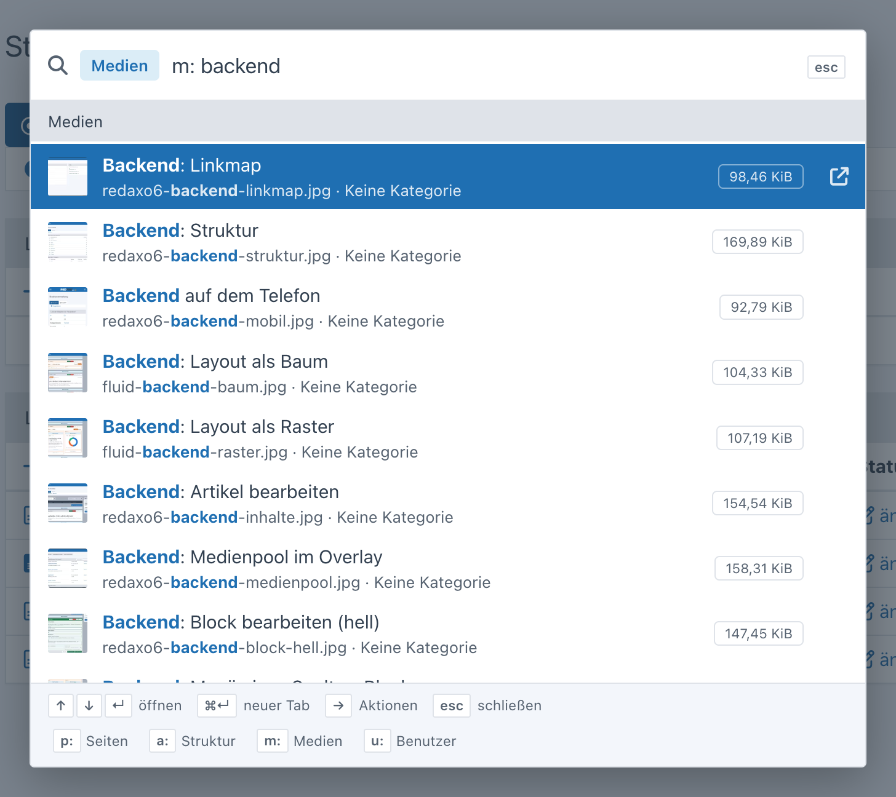
  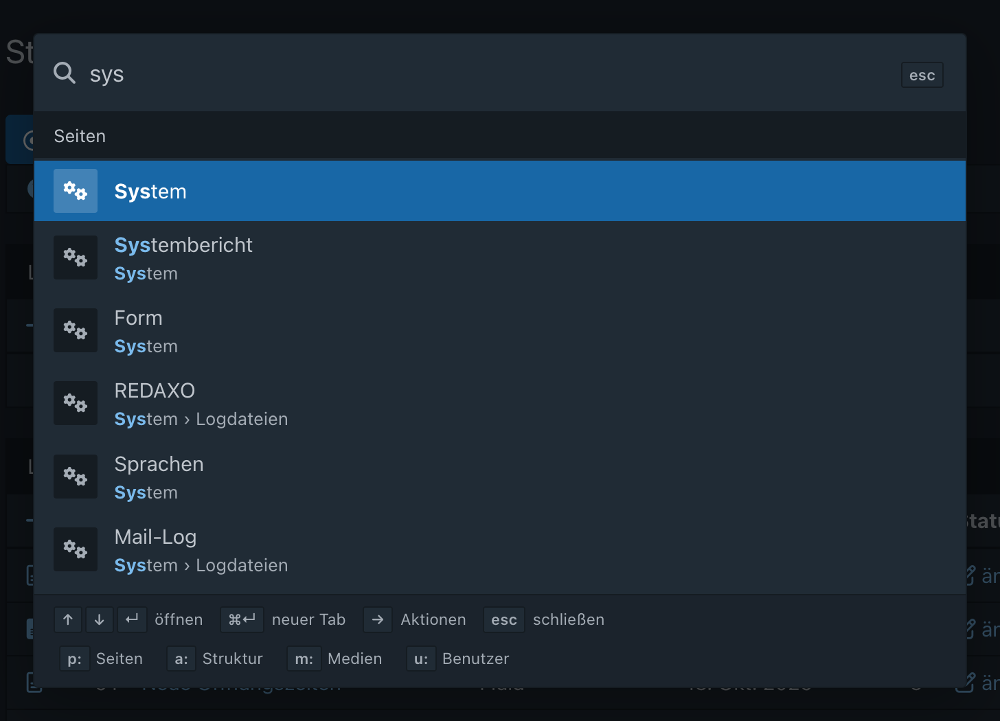
</p>

### Unveröffentlicht

Ist die Arbeitsversion aktiv (System → Einstellungen), listet die Palette Seiten, deren Arbeitsversion vom Live-Stand
abweicht – Blöcke, Reihenfolge, Inhalte oder Status, „neu“ für Seiten ohne Live-Stand. Ohne Eingabe stehen die neuesten
gleich mit in der Palette, `w:` zeigt alle; Pfad, Zeitpunkt und wer zuletzt geändert hat stehen in der zweiten Zeile.
Das gilt für die Arbeitsversion des Cores und damit auch für fluid.

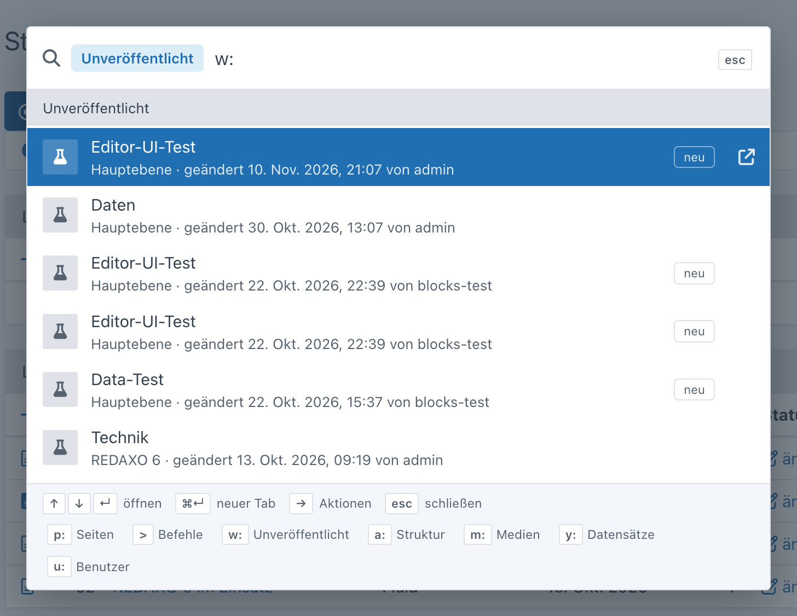

### Befehle

Mit `>` zeigt die Palette Befehle, passende erscheinen auch in der normalen Suche – jeweils nur, wenn der Benutzer sie
ausführen darf:

- Neuer Artikel / neue Kategorie – in der Kategorie, in der man gerade ist (sonst Hauptebene)
- Medium hochladen
- Neuer Datensatz für jede YForm-Tabelle mit Bearbeitungsrecht
- nur Admins: Tabellenstruktur bearbeiten (YForm-Designer), neuer Benutzer, Cache löschen

Befehle landen nicht unter „Zuletzt geöffnet“.

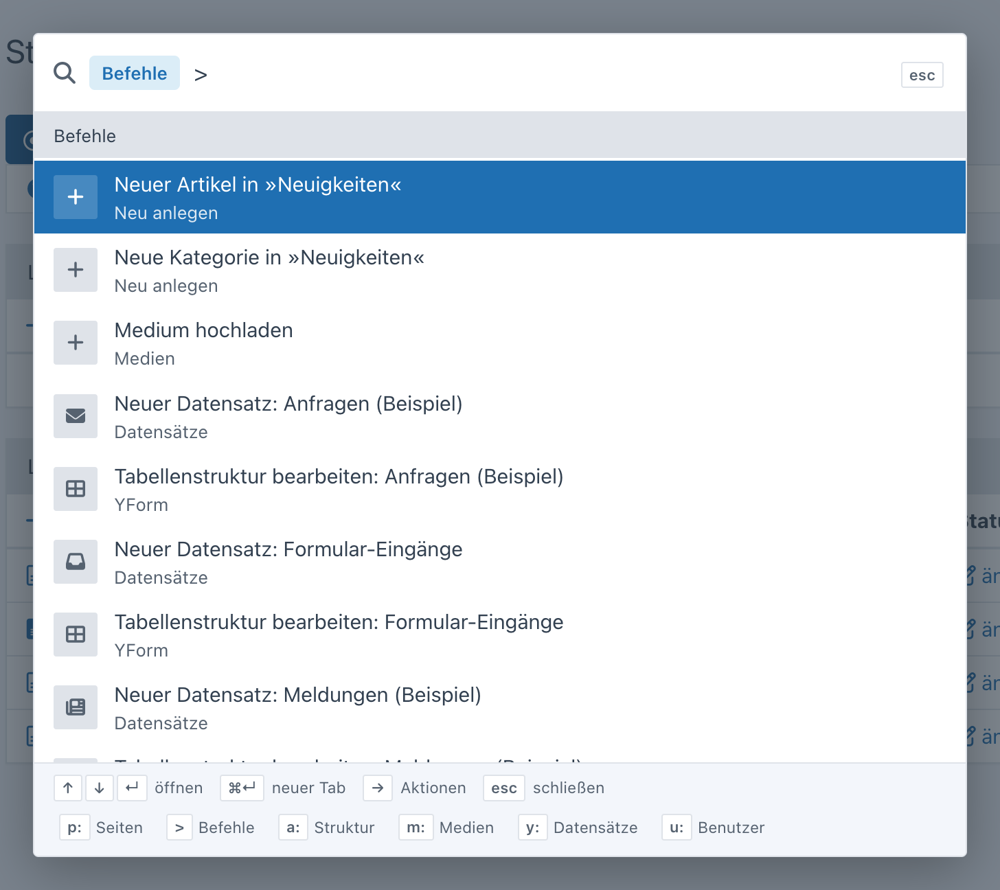

Weitere Befehle trägt ein AddOn über den Extension Point `QuickNavigationCommands` ein (Liste von `Item`, Rechte über
`$ep->query->user`):

```php
Extension::register(QuickNavigationCommands::class, static function (QuickNavigationCommands $ep): array {
    $commands = $ep->subject;
    if ($ep->query->user->admin) {
        $commands[] = new Item('Sitemap neu erzeugen', Url::backendPage('seo/sitemap', ['func' => 'generate']), icon: 'rex-icon fa-sitemap');
    }

    return $commands;
});
```

## Strukturbaum

Der Knopf neben der Lupe öffnet die Struktur als Baum – aufgeklappt bis zum Artikel bzw. zur Kategorie, auf der man
gerade ist. Unterebenen werden erst beim Aufklappen geladen. Ein Klick auf eine Kategorie öffnet sie in der Struktur,
auf einen Artikel dessen Inhalt; „Inhalt bearbeiten“ und „Ansehen“ erscheinen beim Überfahren. Bei mehreren Sprachen
wird oben umgeschaltet. Wer nur Teile der Struktur darf, sieht seine Mountpoints.

Das Suchfeld oben im Baum durchsucht die ganze Struktur (Name oder ID) und zeigt nur die Treffer mit ihren Kategorien,
aufgeklappt.

<p>
  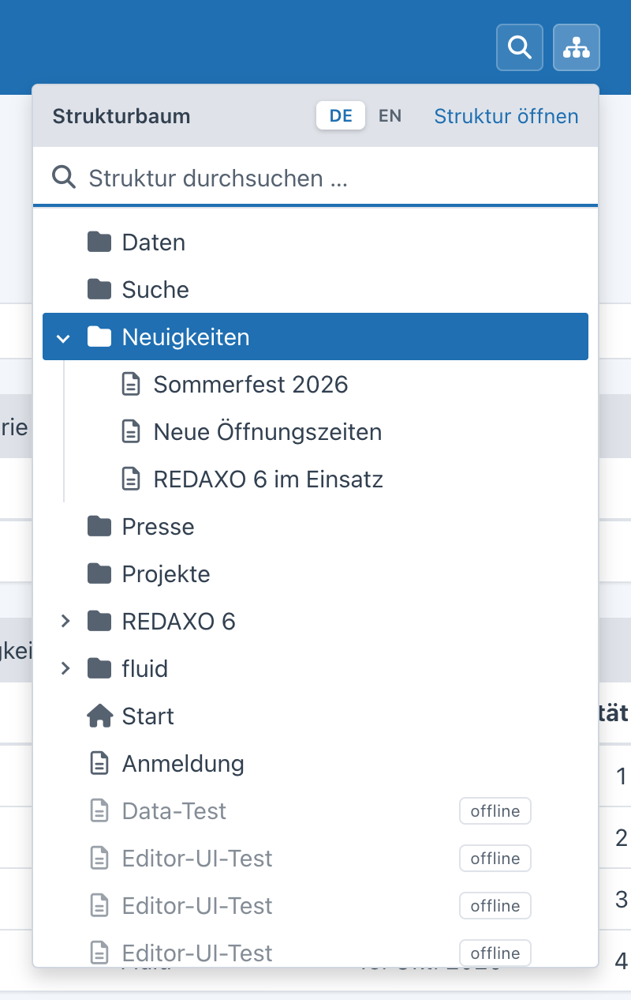
  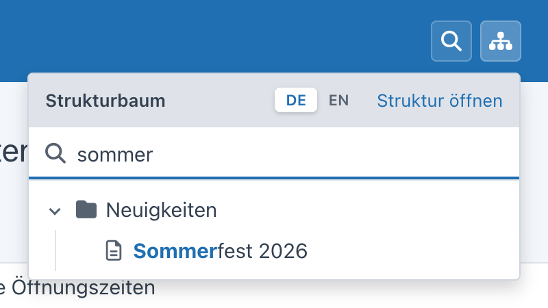
</p>

Tastatur: Das Suchfeld hat beim Öffnen den Fokus, ↓ springt in den Baum, ↵ öffnet den ersten Treffer. Im Baum: ↑ ↓,
→ aufklappen bzw. hinein, ← zuklappen bzw. hinauf, Pos1/Ende, ↵ öffnen (⌘↵ neuer Tab), ein Buchstabe springt zum
nächsten Eintrag mit diesem Anfang, esc schließt.

## YForm

Mit YForm erscheint ein dritter Knopf in der Kopfleiste: Er listet die Tabellen, die der Benutzer sehen darf (ab sieben
mit Filter), „+“ legt direkt einen neuen Datensatz an (nur mit Bearbeitungsrecht), und „In Datensätzen suchen“ öffnet die
Palette mit `y:`. Die Suche geht über alle Textfelder der erlaubten Tabellen; ohne Suchbegriff zeigt `y:` die neuesten
Datensätze je Tabelle.

<p>
  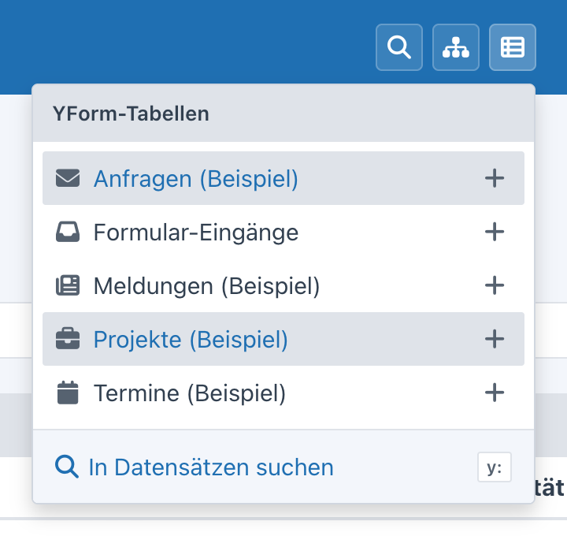
  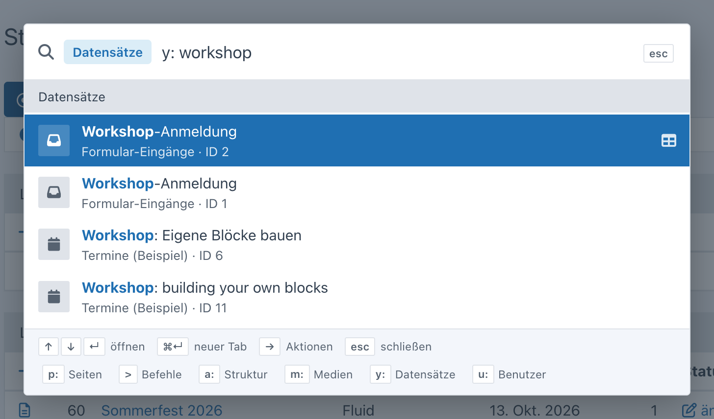
</p>

## Medienpool

Der Medienpool läuft in REDAXO 6 als eigenes Fenster bzw. als Overlay beim Auswählen eines Mediums. Dort erweitert
Quick Navigation das vorhandene Suchfeld:

- **Live-Suche:** Treffer erscheinen beim Tippen unter dem Feld (Vorschaubild, Dateiname, Kategorie, Größe), ↑ ↓ wählen,
  ↵ öffnet das Medium.
- **Zuletzt bearbeitet:** ein Klick ins leere Suchfeld zeigt die zuletzt geänderten Medien.
- **Auswählen:** im Auswahl-Modus eines Medienfelds hat jeder Treffer „übernehmen“, ↵ übernimmt direkt; die erlaubten
  Dateitypen des Felds gelten auch hier.
- **Sortierung:** der Knopf neben der Suche schaltet die Liste zwischen „neueste zuerst“, Dateiname und Titel um
  (bleibt gespeichert).
- **Blättern:** in der Detailansicht eines Mediums führen ‹ › (oder die Pfeiltasten ← →) zum vorigen bzw. nächsten
  Medium – in derselben Reihenfolge wie die Liste (Kategorie, Dateitypen, Sortierung); beim Überfahren zeigt eine
  Vorschau, wohin es geht. Auch im Auswahl-Modus, „übernehmen“ bleibt.

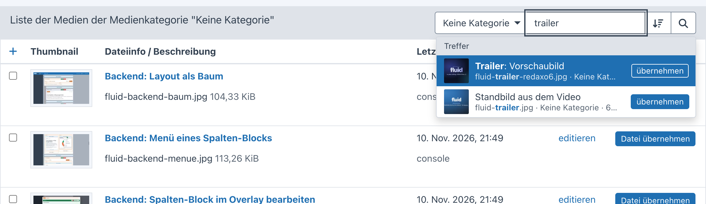

## Rechte

Die Suche läuft über API-Funktionen (nur lesend, mit CSRF-Token). Jede Quelle prüft selbst:

- **Seiten:** `Page::checkPermission()` – wie die Navigation; versteckte Seiten und Popups bleiben draußen
- **Struktur und Baum:** Kategorie-Rechte (`StructurePermission`, Mountpoints) und Sprach-Rechte
- **Medien:** Medienpool-Rechte je Kategorie (`MediaPoolPermission`)
- **YForm:** Lese- bzw. Bearbeitungsrecht je Tabelle (`Access::canView()`/`canEdit()`); „+“ nur mit Bearbeitungsrecht
- **Benutzer:** Recht `users[]`; Administratoren sehen nur Administratoren
- **Unveröffentlicht:** Kategorie- und Sprach-Rechte wie in der Struktur
- **Befehle:** je Befehl das passende Recht (Anlegen in der Kategorie, Medienpool, YForm-Bearbeitung); Designer, neuer
  Benutzer und Cache löschen nur für Admins

## Eigene Quellen

Ein AddOn liefert Treffer mit einer Klasse, die `Provider` implementiert und das Attribut `AsProvider` trägt – mehr
braucht es nicht, die Klasse wird automatisch gefunden:

```php
use FriendsOfRedaxo\QuickNavigation\Action;
use FriendsOfRedaxo\QuickNavigation\AsProvider;
use FriendsOfRedaxo\QuickNavigation\Item;
use FriendsOfRedaxo\QuickNavigation\Provider;
use FriendsOfRedaxo\QuickNavigation\Query;
use Redaxo\Core\Filesystem\Url;

#[AsProvider('news', priority: 40, prefix: 'n')]
final class NewsProvider implements Provider
{
    public function label(?Query $query = null): string
    {
        return 'News';
    }

    public function search(Query $query): iterable
    {
        // Rechte prüfen – nur liefern, was der Benutzer öffnen darf
        if ($query->isEmpty() || !$query->user->hasPerm('news[]')) {
            return;
        }

        foreach (News::query()->where('title', $query->like(), 'LIKE')->find() as $news) {
            $score = $query->score($news->title, $news->teaser);
            if (0 === $score) {
                continue;
            }

            yield new Item(
                title: $news->title,
                url: Url::backendPage('news', ['func' => 'edit', 'id' => $news->id]),
                meta: $news->date->format('d.m.Y'),
                icon: 'rex-icon fa-newspaper',
                badge: $news->online ? null : 'offline',
                actions: [new Action('Ansehen', $news->getUrl(), 'rex-icon rex-icon-external-link', external: true)],
                score: $score,
            );
        }
    }
}
```

- `AsProvider(key, priority, prefix)` – `priority` ordnet die Gruppen (Seiten 100, Befehle 95, Unveröffentlicht 92, Struktur 90, Medien 80,
  YForm 60, Benutzer 50),
  ein gleicher `key` mit höherer Priorität ersetzt eine vorhandene Quelle, `prefix` ist das Kürzel für `x:`.
- `Query` – `term`, `words`, `user`, `limit`, `scoped` (per Kürzel gewählt), `isEmpty()`, `isId()`, `like()` (fertiges
  Muster für SQL `LIKE`) und `score()` für die Reihenfolge (gleich > beginnt mit > Wortanfang > enthalten, 0 = passt
  nicht).
- `Item` – Titel, Adresse, zweite Zeile, Icon oder Vorschaubild, Badge, Zusatzaktionen; `score` sortiert innerhalb der
  Gruppe.
- Bei leerer Eingabe darf eine Quelle Vorschläge liefern (z. B. „zuletzt bearbeitet“) oder nichts.

Ohne Attribut, etwa abhängig von der Konfiguration, im `boot()` des eigenen AddOns:

```php
QuickNavigation::register('news', new NewsProvider(), priority: 40, prefix: 'n');
QuickNavigation::unregister('users'); // eingebaute Quelle abschalten
```

Wirft eine Quelle eine Exception, fehlt nur ihre Gruppe (im Entwicklungsmodus wird der Fehler angezeigt).

## Domains

Quick Navigation kennt selbst keine Domains – AddOns, die welche verwalten (fluid, yrewrite …), tragen sie über den
Extension Point `QuickNavigationDomains` ein. Ab zwei Domains zeigt der Strukturbaum oben eine Auswahl (vorgewählt ist
die Domain der aktuellen Seite, dazu „Alle Domains“): Der Baum beginnt dann in der Einstiegskategorie der Domain, die
Einstiegskategorien der anderen Domains sind ausgeblendet, und die Suche im Baum bleibt in der Domain. In der Palette
tragen Artikel und Kategorien die Domain als Badge.

<p>
  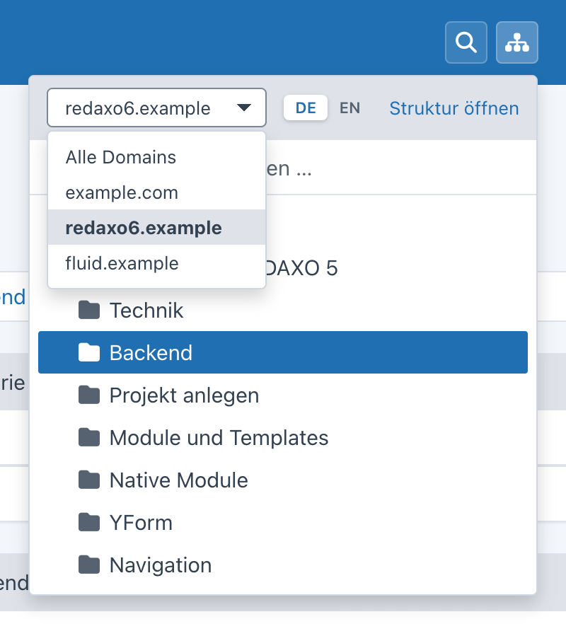
  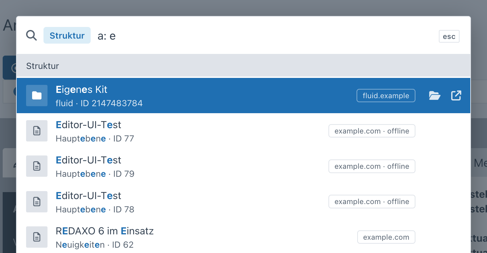
</p>

Eine Domain hat einen Schlüssel, einen Namen, ihre Einstiegskategorie (`0` = ganze Struktur) und die Adresse. Die
Anmeldung schadet nicht, wenn Quick Navigation fehlt – `::class` lädt keine Klasse, die Closure läuft nur, wenn der
Extension Point ausgelöst wird. Für yrewrite zum Beispiel:

```php
use FriendsOfRedaxo\QuickNavigation\Domain\Domain;
use FriendsOfRedaxo\QuickNavigation\ExtensionPoint\QuickNavigationDomains;
use Redaxo\Core\ExtensionPoint\Extension;
use Yakamara\YRewrite\YRewrite;

Extension::register(QuickNavigationDomains::class, static function (QuickNavigationDomains $ep): array {
    $domains = $ep->subject;
    foreach (YRewrite::getDomains() as $name => $domain) {
        if ('default' !== $name) {
            $domains[] = new Domain($name, $domain->getHost(), $domain->getMountId(), $domain->getUrl());
        }
    }

    return $domains;
});
```

Für fluid entsprechend: die Hauptdomain mit `0`, Landing-Domains mit Unterseiten mit ihrer Kategorie.

## Technik

- Lupe, Strukturbaum und YForm-Tabellen als Knöpfe in der Kopfleiste des Backends – ohne Eingriff in den Core
- `<dialog>` mit ARIA-Combobox und Listbox, Baum als ARIA-Tree, Ansagen für Screenreader, `prefers-reduced-motion`
- Farben und Komponenten des Cores (Tokens, Select) – hell und dunkel ohne eigene Regeln
- keine Inline-Styles und -Handler (Content-Security-Policy des Backends)

## Lizenz

MIT, siehe [LICENSE](LICENSE).
